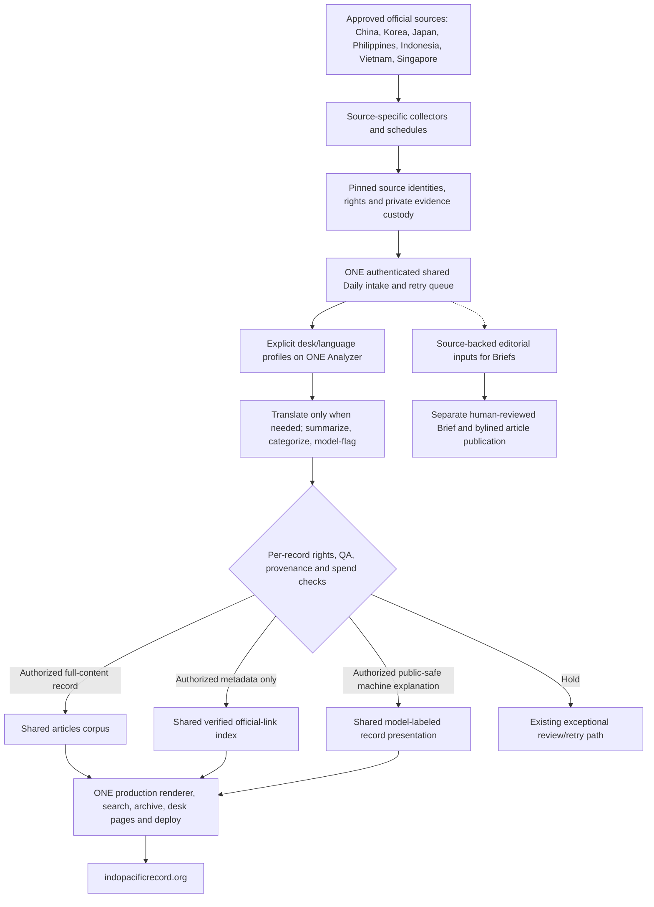

# One shared Daily architecture for Indo-Pacific Record desks

**Owner direction, 19 October 2026 — target architecture, not a claim of current deployment.**
This is a durable default for future desk implementation and convergence of existing desks.
It complements the 18 October complete-desk acceptance rule and the source-specific
rights, custody, and publication decisions in `DECISION_LOG.md`. Historical
collection/release receipts and authorized limitations remain unchanged.

## Outcome

**Build privately; launch completely; operate continuously.** Every agreed
country desk should ultimately contribute to the **same IPR record-processing
and public publication system**, rather than maintain independent article
corpora, separate AI engines, manual per-record pipelines, separate record-page
renderers, or permanent "shadow" visitor experiences.

**One logical Daily is not one physical collector or one giant GitHub Actions
job.** Independently scheduled collectors are often necessary for robots policy,
publisher release times, failure isolation, private originals and first-party
provenance. Their *validated outputs* should converge on a common controlled
intake/processing queue, shared rendering, and coordinated website release.
`daily_update.yml` and `pipeline.py` are the reference coordinator/engine
today; change them minimally where required. Avoid a giant critical-path job
that fails everywhere when one source is unavailable. Source-specific
file-only release workflows may coexist during migration, but should not
become permanent parallel systems when an equivalent shared path is proven.

## Intended end-to-end flow

1. **Collect at the official source:** each authorized source-family adapter
   follows its observed access/robots/crawl and timing contract. Preserve
   original bytes, identifiers, publisher and issuing-office distinctions,
   chronology, exact hashes, attempt ledgers and source versions in suitable
   custody. Private-first originals stay private.
2. **Authenticated common intake:** consume a source-pinned, read-only
   projection from the legitimate collector, never scrape the same publisher
   twice merely to feed Daily. Verify provenance, custody, coverage, version,
   identity, canonical URLs, rights and integrity before admitting anything.
   A quiet source day yields zero new records, not a fabricated article.
3. **One shared processing engine:** select an explicit **desk-specific
   processing profile** on the common queue. Apply relevance screening,
   translation **only if the original is not already in the publication
   language**, source-attributed summary, topic/category triage and
   "model-flagged" classification as applicable. Unknown/unregistered desks
   must fail closed; never fall back to China's PLA-focused prompts.
   Store per-record source/prompt/model version and retry/hold information.
4. **Automatic quality and rights gates:** enforce source-use permissions for
   each distinct use—private retention, model processing, public source
   metadata, original title/body, translation, derivative or model-generated
   summary/analysis, images and external documents. Robots/access compliance
   is not a reuse licence. Verify completeness, dates, quantities, personal
   names, ranks, issuers, key terminology, contradictions and attribution
   against actual evidence where checks are feasible. Model output is not
   independent corroboration. Hold only affected records; bound retry and
   spend, preserve failure artifacts and actionable reasons.
5. **Shared public products:** a rights-cleared full-text original can enter
   the common `articles` corpus under the ordinary record contract. A
   source restricted to verified link metadata stays a source-link record;
   do **not** copy protected title/body into public `pla_watch.db` merely to
   increase article counts. Publicly published original IPR explanation or
   machine summaries require their **own** approved publication basis and a
   public-safe output schema; source links and articles must be visibly
   differentiated. Reuse `site/render.py`, the archive/search/desk pages
   and normal deploy/readback. Do not build duplicate record websites.
6. **Unattended normal operation:** once a desk's specific source-use,
   machine-processing, quality, spend and public-release policies have been
   explicitly authorized and the real end-to-end route verified, normal
   qualifying *machine-labeled record output* should publish without
   daily per-article editorial approval. Ambiguity, rights changes, failed
   verification, source anomalies and meaningful quality failures go to
   exceptional review rather than silently publish.
7. **Distinct human editorial layer:** IPR Briefs, bylined original analysis,
   manuscript sign-off and human authorship remain separately editor/owner
   controlled. A machine-produced source readout cannot be relabeled
   analyst-authored, and this architectural target is not standing approval
   to auto-publish Briefs.

## Profile and rights examples

| Source/desk | Language handling | Target processing | Existing policy boundary |
|---|---|---|---|
| China | Chinese→English when required | Preserve today's working shared Daily behavior | Existing record, reuse and publisher contracts |
| Singapore | English original | Explicit Singapore screening and English summary; no fake translation | Existing approved source/publication behavior |
| South Korea MND | Korean→English | Source-pinned private original → shared profile and quality gate → unattended qualifying machine record | KOGL Type 1 applies only to actually eligible verified original text; DAPA metadata-only scope is separate |
| Philippines AFP | English original | Existing private AFP collector → common intake and Philippines-specific summary/topics → qualifying public record | Oct 18 AFP authorization is **neutral link metadata only**, not automatic text/model/public-analysis approval |
| Philippines NSC | English original | Use same Philippines processing profile when eligible original evidence exists | NSC metadata, model processing and category anomaly have separate unresolved owner decisions |
| Indonesia, Vietnam, Japan, other desks | Source's actual language | Reuse the shared processing, archive and release semantics with desk profiles | No cross-family permission inheritance or speculative source activation |

Do not infer that any desk currently satisfies the target solely because a
profile, manifest, PR, private collector or synthetic test exists. Even a
working link-only desk is not equivalent to a completed content/analysis desk.

## The desk system at a glance (target, not current completion status)

The common Daily is a **logical processing and publication system**. Source
collectors can run earlier/later, in private Git, or as isolated Actions jobs;
their validated output must converge. Do not force unrelated publisher
requests into one giant job, or make an unavailable source block unrelated
work. Keep existing specialized publication workflows only where they enforce
a genuine source-specific security or rights boundary; converge overlapping
record processing, site rendering and routine release rather than copying
them per country.

## Implementation rule: deliver the desk, not the scaffolding

These rules apply to **every** current and future desk and all coding-agent
sessions. They are the default when the owner says "finish", "complete",
"get it working", "100%" or "make it operational":

1. **Ship the minimum complete vertical slice:** one real eligible source
   identity and exact version → authorized intake → proper language-specific
   screening/translation if required → model summary/classification as
   permitted → authorized public record/link representation → normal website
   deploy/readback → maintained automatic cycle. Quiet sources are not errors.
   The accepted agreed source scope, not arbitrary institutional expansion,
   defines completeness.
2. **Reuse first, every time:** existing collectors, original custody,
   authenticated source bridge, `pipeline.py`, `Analyzer`, `pla_watch.db`
   contracts, `site/render.py`, Actions, retry/billing and deployed readback.
   Before adding a new component, state the specific missing capability that
   none of these can satisfy, and justify the smallest compatible extension.
3. **Do not proliferate systems:** no permanent shadow/development publication
   lane, second national corpus/AI engine/renderer, country-specific Brief
   generator, duplicate queue, manual per-record sign-off for already
   authorized machine record outputs, speculative dashboards, arbitrary
   waiting streaks, multiple overlapping PRs, or more audit/test frameworks
   when an existing focused check would cover the risk.
4. **Safety should be concentrated, not multiplied:** retain one meaningful
   check at each genuine boundary (publisher access, evidence custody,
   source rights, model spend/quality, database integrity, concurrency and
   deployment); keep historical receipts and narrow exception holds. A
   second approval process proving the same fact needs a demonstrated reason.
5. **One reviewable, production-directed change:** work from current live
   status, make the smallest coherent end-to-end implementation with only an
   essential private companion, run the existing required tests, and ask the
   owner for only real release/rights/spend decisions. Do not stop at an
   inactive profile, another roadmap, a "ready" label or synthetic tests
   while safe implementation remains possible.
6. **Unattended normal operation:** after genuine source-specific permission,
   quality acceptance and spending approval, qualifying, clearly labeled
   machine record content publishes without routine owner/editor action.
   Only exceptional records hold. Human-authored Briefs, human bylines and
   independently editorialized analysis retain explicit human approvals.
7. **Tell the truth about progress:** a green preflight, synthetic record,
   metadata link, collection attempt or model prompt is not a deployed,
   analyzed article. Report what truly runs, what publishes, and the one
   material blocker if anything still prevents the full agreed visitor
   experience.

**Do not interpret "make the desk work" as permission to add systems or
override source rights.** The owner prefers the shortest *credible*
end-to-end route, not a shortcut around authenticity, licensing, accuracy or
human editorial authority. If a path is blocked, build the safe remainder,
identify the exact decision needed, and stop proposing unnecessary stages.

## Implementation priorities

- Preserve live collector/source custody and already verified public releases.
- Consolidate **processing and rendering first**, not physical collection
  schedules. Reuse existing analyzer, queue, budget/retry, DB migration and
  Pages safety mechanisms. Prefer one coordinated, small public integration
  change and an essential private companion only when a custody boundary
  demands it.
- For Philippines: skip translation altogether for English originals; adopt
  one explicit English-language profile with AFP/NSC factual and maritime/
  defense context. Use the 32 verified AFP link records as source-identity
  anchors; don't pretend metadata authority permits public originals or
  AI-derived publication. NSC's genuine quiet period is normal.
- For Korea: connect licensed, hash-pinned MND originals to the shared queue,
  verify Korean translation against a versioned terminology/quality set,
  and route qualifying machine English through common publishing; retain
  DAPA metadata-only restrictions. Prompt examples are not fine-tuning.
- Build an authentic small end-to-end rehearsal before a broad backfill:
  official evidence → exact version and rights → shared processing →
  governed SQLite/public-safe projection → generated record and desk →
  main/gh-pages/live HTTPS byte/identity readback. Separately observe the
  first subsequent ordinary unattended cycle.
- No mandatory seven-/30-day waiting milestone, new data pipeline for each
  desk, standalone analysis engine, duplicate database or endless phased
  shadow program. Preserve historical receipts and meaningful monitoring.

## Explicit authority boundary

**This document records the owner's preferred architecture and operating
model. It is not an immediate production activation or blanket licence.**
It does not itself authorize a new model expense, private-to-public data
transfer, public original title/body/image, machine-processing of a family
with unapproved rights, public derivative text, a PR merge, a scheduled
workflow, a change to signed credentials, a desk status promotion or an
unreviewed human-byline publication. Such changes follow actual standing or
new specific owner decisions and verified source constraints.

When source-use questions remain, implement the safe shared infrastructure
and present **one precise decision** for the blocked source family/output.
No routine manual approvals are the intended long-term path for *already
authorized, quality-passing machine output*, but neither the model nor its
passing tests may invent the authorizations.
