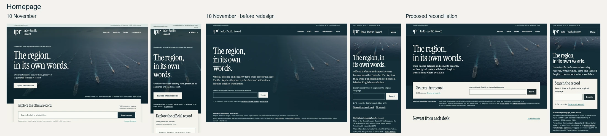
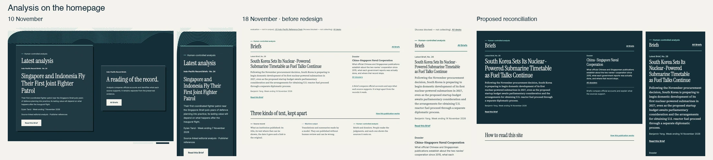
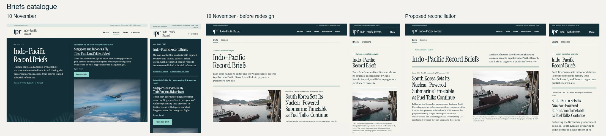
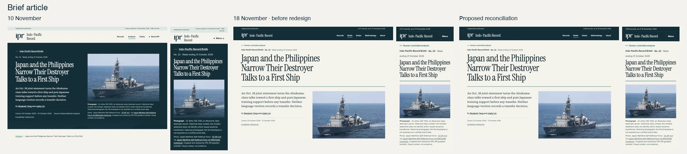
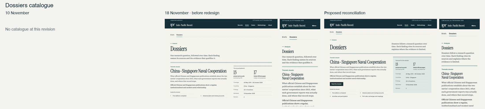
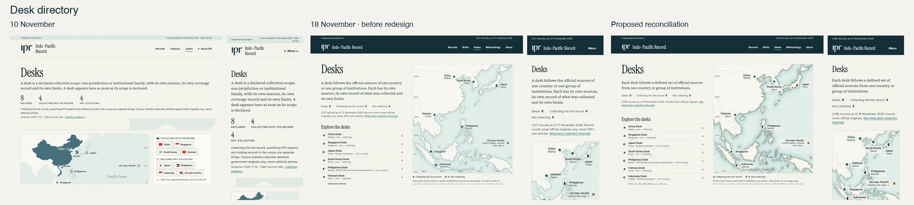
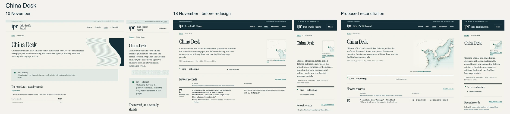
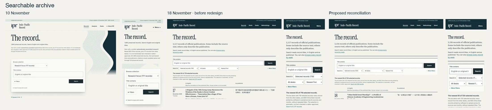
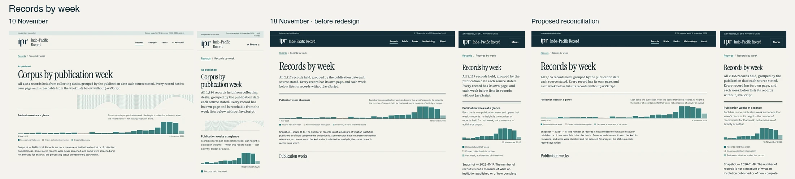

# Editorial reconciliation · founder visual review

The homepage opens with the fleet in view, then gives the reader a paper search field with the current corpus count. On a short phone the image becomes shallower so the field and submit button fit on the first screen. The navy Briefs spread marks the transition from official publications to human analysis. Its second column carries a published dossier when one is available.

## Compare the pages

Each sheet pairs desktop and mobile views of November 10, November 18 before the redesign, and the proposal, from left to right. The links following each sheet open the individual captures at their native resolution.

### Homepage

- November 10 · [desktop](nov10/1280/home.webp) · [mobile](nov10/375/home.webp)
- November 18 · [desktop](nov18/1280/home.webp) · [mobile](nov18/375/home.webp)
- Proposal · [desktop](proposed/1280/home.webp) · [mobile](proposed/375/home.webp)

### Analysis on the homepage

- November 10 · [desktop](nov10/1280/home-analysis.webp) · [mobile](nov10/375/home-analysis.webp)
- November 18 · [desktop](nov18/1280/home-analysis.webp) · [mobile](nov18/375/home-analysis.webp)
- Proposal · [desktop](proposed/1280/home-analysis.webp) · [mobile](proposed/375/home-analysis.webp)

### Briefs catalogue

- November 10 · [desktop](nov10/1280/briefs.webp) · [mobile](nov10/375/briefs.webp)
- November 18 · [desktop](nov18/1280/briefs.webp) · [mobile](nov18/375/briefs.webp)
- Proposal · [desktop](proposed/1280/briefs.webp) · [mobile](proposed/375/briefs.webp)

### Brief article

- November 10 · [desktop](nov10/1280/article.webp) · [mobile](nov10/375/article.webp)
- November 18 · [desktop](nov18/1280/article.webp) · [mobile](nov18/375/article.webp)
- Proposal · [desktop](proposed/1280/article.webp) · [mobile](proposed/375/article.webp)

### Dossiers catalogue

- November 18 · [desktop](nov18/1280/dossiers.webp) · [mobile](nov18/375/dossiers.webp)
- Proposal · [desktop](proposed/1280/dossiers.webp) · [mobile](proposed/375/dossiers.webp)

### Desks and atlas

- November 10 · [desktop](nov10/1280/desks.webp) · [mobile](nov10/375/desks.webp)
- November 18 · [desktop](nov18/1280/desks.webp) · [mobile](nov18/375/desks.webp)
- Proposal · [desktop](proposed/1280/desks.webp) · [mobile](proposed/375/desks.webp)

### China Desk

- November 10 · [desktop](nov10/1280/china.webp) · [mobile](nov10/375/china.webp)
- November 18 · [desktop](nov18/1280/china.webp) · [mobile](nov18/375/china.webp)
- Proposal · [desktop](proposed/1280/china.webp) · [mobile](proposed/375/china.webp)

### Searchable archive

- November 10 · [desktop](nov10/1280/archive.webp) · [mobile](nov10/375/archive.webp)
- November 18 · [desktop](nov18/1280/archive.webp) · [mobile](nov18/375/archive.webp)
- Proposal · [desktop](proposed/1280/archive.webp) · [mobile](proposed/375/archive.webp)

### Individual Record

- November 10 · [desktop](nov10/1280/records.webp) · [mobile](nov10/375/records.webp)
- November 18 · [desktop](nov18/1280/records.webp) · [mobile](nov18/375/records.webp)
- Proposal · [desktop](proposed/1280/records.webp) · [mobile](proposed/375/records.webp)

### Records by week

- November 10 · [desktop](nov10/1280/weekly.webp) · [mobile](nov10/375/weekly.webp)
- November 18 · [desktop](nov18/1280/weekly.webp) · [mobile](nov18/375/weekly.webp)
- Proposal · [desktop](proposed/1280/weekly.webp) · [mobile](proposed/375/weekly.webp)

## Capture method

The November 10 reference is the committed static output at `365e767ba79f5694ae9043dcfb320b3150ee9fa7`. Its masthead reports a November 10 corpus of 1,884 records. The November 18 pre-redesign reference is the committed static output at `ff62c4618c0bf452f3612111c0104cffcaa346a5`. Its masthead reports a November 17 corpus of 2,117 records. Each was served directly from its own detached worktree over localhost. These are captures of the preserved Git snapshots. No historical renderer ran, and neither snapshot used a current database.

Chromium 147.0.7727.15 captured at 1280 × 900 and 375 × 812 CSS pixels, device scale factor 1, default browser font size, and reduced motion. The capture waits for loaded pages, locally served fonts and visible images to decode. Screenshots use WebP. Each view starts at the top except the analysis view, which starts at the homepage's analysis section. Changes in headlines and counts between the references reflect each snapshot's published corpus.

| View | Route |
| --- | --- |
| Homepage | `index.html` |
| Homepage analysis | `index.html#analysis` |
| Desk directory | `desks.html` |
| Individual desk | `china.html` |
| Searchable archive | `archive.html` |
| Record | `record/1002.html` |
| Weekly record index | `corpus.html` |
| Briefs catalogue | `analysis.html` |
| Brief article | `briefs/japan-philippines-first-destroyer-2026.html` |
| Dossiers catalogue | `dossiers.html` (absent from November 10) |

The proposal uses the production renderer, the November 18 main snapshot of 2,156 records, and its own local output. All images depict published material. The atlas markers identify publishing institutions. Their glyphs and accessible labels carry the registry state.
